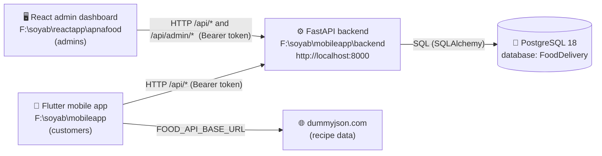
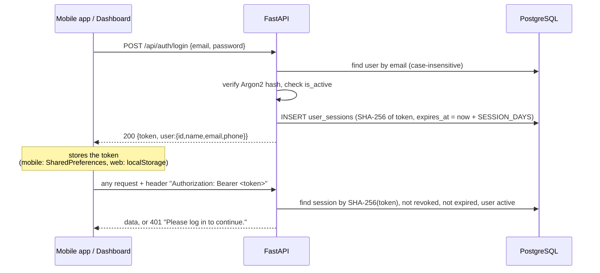
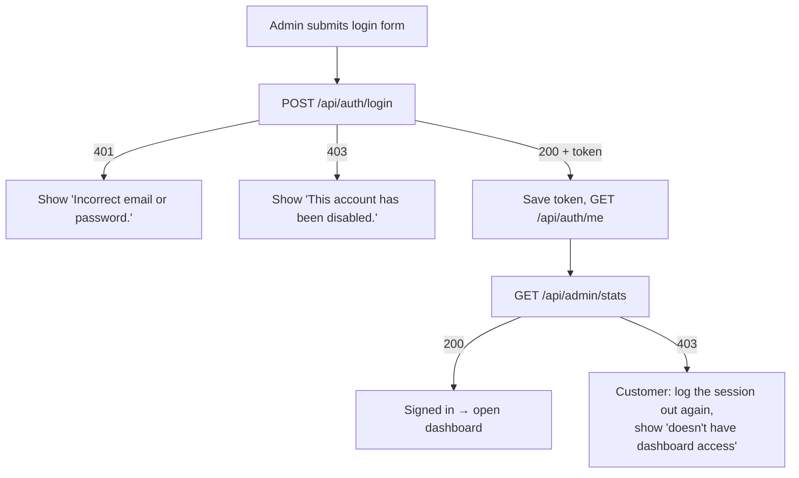
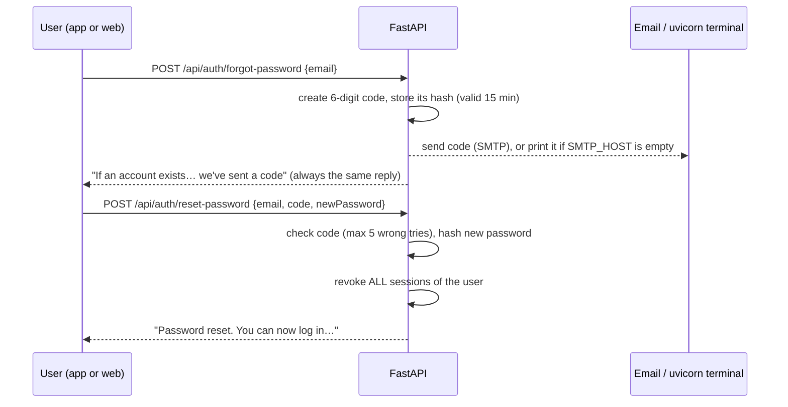
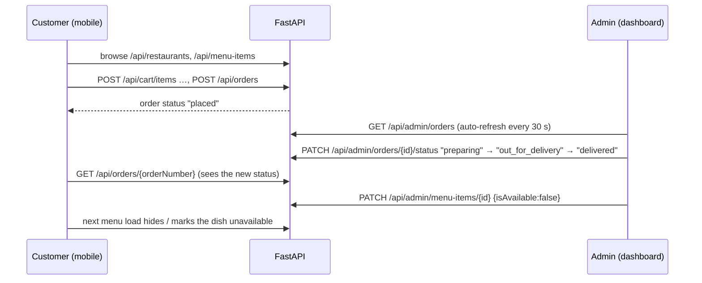

# Apna Food — Project Flow, Login & Admin Guide

How the mobile app, the backend, the database and the web dashboard fit together,
how login works on each side, and how to control who can reach the admin dashboard.

---

## 1. The big picture

There are **three apps** and **one database**. Only the backend talks to the database.



| Part | Folder | Runs on | Who uses it |
|---|---|---|---|
| Mobile app (Flutter) | `F:\soyab\mobileapp` | Android emulator / phone | Customers |
| Backend API (FastAPI + SQLAlchemy + Alembic) | `F:\soyab\mobileapp\backend` | `http://localhost:8000` | Both apps |
| Admin dashboard (React + Vite) | `F:\soyab\reactapp\apnafood` | `http://localhost:5175` (Vite picks the port) | Admins |
| Database (PostgreSQL 18) | Windows service `postgresql-x64-18` | `localhost:5432` | Backend only |

**Key rule:** neither app holds the database password. Both log in to the backend and get a
token; the backend decides what each token is allowed to do.

---

## 2. The three configuration files

| File | Belongs to | Secret? | What it controls |
|---|---|---|---|
| `F:\soyab\mobileapp\.env` | Flutter app | **No** — compiled into the app | Which backend the app calls (`BACKEND_MODE`, `BACKEND_BASE_URL`) |
| `F:\soyab\mobileapp\backend\.env` | FastAPI | **Yes** | Database URL + password, first admin account, email (SMTP), session length |
| `F:\soyab\reactapp\apnafood\.env.example` | Dashboard | No | Only a template; defaults already work, no `.env` needed |

### 2.1 Mobile app `.env` (the file you pasted)

```ini
FOOD_API_BASE_URL=https://dummyjson.com      # recipe/food data provider
BACKEND_MODE=http                            # mock = fake on-device backend, http = real FastAPI
BACKEND_BASE_URL=http://10.0.2.2:8000/api    # where the real backend is
API_TIMEOUT_SECONDS=15
MOCK_LATENCY_MS=600                          # only used when BACKEND_MODE=mock
```

- It is read at **build time**: `flutter run --dart-define-from-file=.env`
  (see `lib/core/config/app_config.dart`). Changing it requires a rebuild, not a hot reload.
- `BACKEND_MODE=http` is what connects the app to your real database. With `mock`, login and
  orders are faked on the phone and **nothing reaches PostgreSQL**.
- `10.0.2.2` is how the **Android emulator** reaches your PC's `localhost`. Other targets:

  | Running on | `BACKEND_BASE_URL` |
  |---|---|
  | Android emulator | `http://10.0.2.2:8000/api` |
  | Real phone on the same Wi-Fi | `http://<your PC's LAN IP>:8000/api` (e.g. `http://192.168.1.20:8000/api`), and start uvicorn with `--host 0.0.0.0` |
  | Flutter web / desktop / iOS simulator | `http://localhost:8000/api` |

- Never put secrets here: anything compiled into a mobile app can be extracted.

### 2.2 Backend `.env` (the important one)

```ini
DATABASE_URL=postgresql+psycopg://postgres:<password>@localhost:5432/FoodDelivery
CORS_ORIGINS=http://localhost:3000,http://localhost:5173
SESSION_DAYS=30                       # how long a login token lasts
PASSWORD_RESET_MINUTES=15             # reset code lifetime
PASSWORD_RESET_MAX_ATTEMPTS=5
PASSWORD_RESET_RESEND_SECONDS=45
SMTP_HOST=                            # empty = reset codes printed in the uvicorn terminal
ADMIN_EMAIL=admin@apnafood.com        # used ONLY by scripts/seed.py
ADMIN_PASSWORD=...                    # used ONLY by scripts/seed.py
```

Restart uvicorn after editing it. `ADMIN_PASSWORD` is only applied when `scripts/seed.py`
creates the admin; changing it later does **not** change the existing admin's password
(use Forgot password or Settings → Change password for that).

---

## 3. Start everything (correct order)

```powershell
# 1. PostgreSQL — normally already running as a Windows service.

# 2. Backend
cd F:\soyab\mobileapp\backend
.venv\Scripts\activate
uvicorn app.main:app --reload --host 0.0.0.0 --port 8000
#    check: http://localhost:8000/health  ->  {"status":"ok","database":"ok"}
#    API docs (try every endpoint): http://localhost:8000/docs

# 3a. Web dashboard
cd F:\soyab\reactapp\apnafood
npm run dev                      # open the URL it prints, e.g. http://localhost:5175

# 3b. Mobile app
cd F:\soyab\mobileapp
flutter run --dart-define-from-file=.env
```

The dashboard's Vite dev server forwards `/api` and `/media` to `http://127.0.0.1:8000`
(`vite.config.js`), so the backend's `CORS_ORIGINS` doesn't need the dashboard's port.

---

## 4. Users and roles

Everyone — customers and admins — lives in the **same `users` table**.

| Column | Meaning |
|---|---|
| `role` | `customer` or `admin` (PostgreSQL enum `user_role`) |
| `is_active` | `false` = account disabled; can't log in, existing tokens stop working |
| `password_hash` | Argon2id hash — the real password is never stored |

| | Mobile app | Web dashboard |
|---|---|---|
| Customer | ✅ can log in and order | ❌ "This account doesn't have dashboard access" |
| Admin | ✅ can log in (it's a normal account too) | ✅ full access |
| Disabled (`is_active=false`) | ❌ | ❌ |

**Registration always creates a customer**, from either app. Admin access is granted
afterwards by an existing admin.

---

## 5. How login works (both apps)

Both apps use the **same endpoints** and the **same token system**.



**Token facts**

- A random 32-byte token (`secrets.token_urlsafe`). Only its **SHA-256 hash** is stored in
  `user_sessions.token_hash`, so a leaked database can't be used to log in.
- Valid for `SESSION_DAYS` (30). One row per login, so each device has its own session.
- **Logout** (`POST /api/auth/logout`) sets `revoked_at` on that session only.
- **Password reset** revokes **all** sessions of that user (every device is signed out).

**Where the code is**

| Concern | File |
|---|---|
| Hashing & tokens | `mobileapp/backend/app/core/security.py` |
| "Who is calling?" checks (`CurrentUser`, `AdminUser`) | `mobileapp/backend/app/api/deps.py` |
| Login / register / reset routes | `mobileapp/backend/app/api/routes/auth.py` |
| Mobile: HTTP client that adds the Bearer header | `mobileapp/lib/core/api/api_client.dart` |
| Mobile: backend URL & mode | `mobileapp/lib/core/config/app_config.dart` |
| Web: HTTP client, token storage, 401 handling | `apnafood/src/lib/api.js` |
| Web: session restore, admin check, login/logout | `apnafood/src/auth/AuthProvider.jsx` |
| Web: route guards | `apnafood/src/auth/RequireAdmin.jsx` |

---

## 6. How the dashboard decides "admin or not"

The backend has three levels of protection (in `deps.py`):

| Dependency | Used by | No/invalid token | Customer token | Admin token |
|---|---|---|---|---|
| none | `/api/restaurants`, `/api/categories`, … (public catalogue) | ✅ | ✅ | ✅ |
| `CurrentUser` | `/api/auth/me`, `/api/cart`, `/api/orders`, … | 401 | ✅ | ✅ |
| `AdminUser` | **everything under `/api/admin/*`** | 401 | **403** | ✅ |

The login response doesn't include the role, so the dashboard checks it like this:



After that, **every** dashboard request goes to `/api/admin/*`, so the backend re-checks the role
on each call. Hiding a page in React is only cosmetic; the real protection is the backend's
`AdminUser` check.

When a page loads, the dashboard restores a saved token the same way (`/auth/me` +
`/admin/stats`). Any `401` later (expired, revoked, password reset, account disabled) signs the
admin out automatically.

---

## 7. All login paths

### 7.1 Web dashboard routes (`F:\soyab\reactapp\apnafood`)

| URL | Access | Purpose |
|---|---|---|
| `/login` | Signed-out only | Admin sign in |
| `/register` | Signed-out only | Create account (becomes a **customer**) |
| `/forgot-password` | Signed-out only | Step 1: email → Step 2: 6-digit code + new password |
| `/` | Admin | Overview dashboard |
| `/orders`, `/restaurants`, `/menu-items`, `/categories`, `/offers` | Admin | Operations & catalogue |
| `/customers` | Admin | Users, **grant/remove Admin role**, enable/disable accounts |
| `/notifications` | Admin | Send in-app notifications |
| `/settings` | Admin | Change own password, design system |

Signed-out visitors to any admin URL are sent to `/login` and returned to that page afterwards.

### 7.2 Backend auth endpoints (used by both apps)

| Method & path | Auth | Body | Result |
|---|---|---|---|
| `POST /api/auth/login` | – | `{email, password}` | `{token, user}` · 401 wrong password · 403 disabled |
| `POST /api/auth/register` | – | `{name, email, phone, password}` (password ≥ 8, phone ≥ 10 digits) | `{token, user}` (customer) · 409 email exists |
| `POST /api/auth/logout` | Bearer | – | 204, revokes this session |
| `GET /api/auth/me` | Bearer | – | `{id, name, email, phone}` |
| `POST /api/auth/forgot-password` | – | `{email}` | Same message whether or not the email exists |
| `POST /api/auth/reset-password` | – | `{email, code, newPassword}` | Sets password, signs out all devices |
| `POST /api/auth/change-password` | Bearer | `{currentPassword, newPassword}` | Changes password (other sessions stay) |

### 7.3 Admin endpoints (`/api/admin/*`, admin role required)

| Area | Endpoints |
|---|---|
| Dashboard | `GET /stats` |
| Orders | `GET /orders` (filters: `status`, `restaurantId`, `q`, `from`, `to`, `page`, `pageSize`) · `GET /orders/{id}` · `PATCH /orders/{id}/status` · `PATCH /orders/{id}/payment` |
| Restaurants | `GET/POST /restaurants` · `GET/PATCH/DELETE /restaurants/{id}` |
| Menu items | `GET/POST /menu-items` · `GET/PATCH/DELETE /menu-items/{id}` |
| Categories | `GET/POST /categories` · `PATCH/DELETE /categories/{id}` |
| Offers | `GET/POST /offers` · `PATCH/DELETE /offers/{id}` |
| Users | `GET/POST /users` · `PATCH /users/{id}` (`role`, `isActive`) |
| Notifications | `POST /notifications` (omit `userId` to broadcast) |
| Images | `POST /uploads` (multipart `file`, JPEG/PNG/WebP, ≤ 5 MB) → `{id, url}` · `GET /uploads` (Media Library, with where each image is used) · `DELETE /uploads/{id}` (409 while in use) |

Full interactive reference: **http://localhost:8000/docs**.

---

## 8. Forgot-password flow



- Only the newest code works; asking again within 45 seconds is ignored (anti-spam).
- **Development:** with `SMTP_HOST` empty, look in the **uvicorn terminal** for the code.
- **Real email:** set `SMTP_HOST=smtp.gmail.com`, `SMTP_PORT=587`, `SMTP_USERNAME=you@gmail.com`,
  `SMTP_PASSWORD=<16-char Gmail App Password>` in the backend `.env`, then restart uvicorn.

---

## 9. Controlling access — common admin tasks

### In the dashboard (recommended)

| Task | Where |
|---|---|
| Make someone an admin | Customers → Role → **Admin** |
| Remove dashboard access | Customers → Role → **Customer** |
| Block an account (both apps) | Customers → **Active** switch off |
| Create an admin directly | Customers → **Add User** → Role: Admin |
| Change your own password | Settings → Change password |

You can't change your own role or disable yourself from the dashboard, so you can't lock yourself out.

### Directly in PostgreSQL (when no admin can log in)

Open psql: `"C:\Program Files\PostgreSQL\18\bin\psql.exe" -U postgres -d FoodDelivery`

```sql
-- Who are the admins?
SELECT id, full_name, email, role, is_active FROM users ORDER BY id;

-- Promote an account to admin
UPDATE users SET role = 'admin' WHERE lower(email) = lower('soyabali64@gmail.com');

-- Disable / re-enable an account
UPDATE users SET is_active = false WHERE email = 'someone@example.com';

-- Force-logout a user on every device
UPDATE user_sessions SET revoked_at = now()
WHERE revoked_at IS NULL AND user_id = (SELECT id FROM users WHERE email = 'someone@example.com');
```

Passwords can't be set with SQL (they're Argon2 hashes). Use Forgot password instead; with
SMTP empty, the code appears in the uvicorn terminal.

### Fresh database only

`python scripts/seed.py` (in the backend folder, venv active) creates the first admin from
`ADMIN_EMAIL` / `ADMIN_PASSWORD` plus starter restaurants and dishes.

---

## 10. End-to-end order flow (how the two apps meet)



Everything an admin changes (menu, prices, restaurants, offers, order status) is visible in
the mobile app on its next request — they share one database through one API.

---

## 11. Troubleshooting

| Symptom | Cause / fix |
|---|---|
| Dashboard top bar shows **API offline** | Backend not running → start uvicorn; check `http://localhost:8000/health` |
| "Can't reach the Apna Food API" on login | Same as above |
| "This account doesn't have dashboard access" | Account is a customer → promote it (section 9) |
| "Incorrect email or password" | Wrong password, or email not registered → use Forgot password |
| Mobile app logs in but data doesn't change in the DB | `BACKEND_MODE=mock` → set `http` and rebuild |
| Mobile app can't connect on emulator | `BACKEND_BASE_URL` must use `10.0.2.2`, not `localhost` |
| Mobile app can't connect on a real phone | Use your PC's LAN IP and run uvicorn with `--host 0.0.0.0`; allow port 8000 in Windows Firewall |
| Everyone suddenly logged out | Password was reset, account disabled, or session expired (30 days) |
| Reset email never arrives | `SMTP_HOST` empty → code is in the uvicorn terminal |
| `database: error` on `/health` | PostgreSQL service stopped, or wrong `DATABASE_URL` password |

---

## 12. Security checklist before going live

- [ ] Change the PostgreSQL password and update `DATABASE_URL` (it has been shared in chat).
- [ ] Use a dedicated database user instead of `postgres` for the app.
- [ ] Keep both backend `.env` files out of git (already in `.gitignore`).
- [ ] Serve the API over **HTTPS**; Bearer tokens must never travel over plain HTTP.
- [ ] Mobile: move the token from SharedPreferences to `flutter_secure_storage`.
- [ ] Configure SMTP so reset codes are emailed, not printed.
- [ ] Set `CORS_ORIGINS` to the real dashboard domain in production.
- [ ] Keep at least two admin accounts so one can recover the other.
